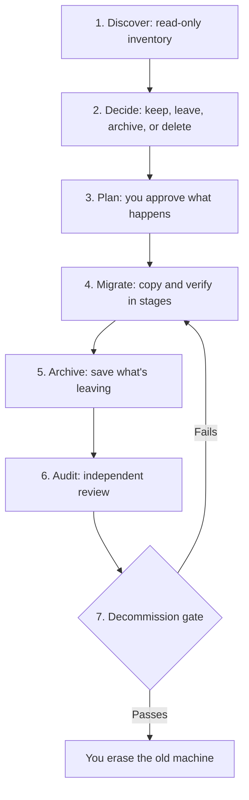

# How it works

The skill splits the work three ways, so each part is done by whatever does it best.

| Who | Does what |
|---|---|
| **You** | Make decisions, approve plans, handle sign-ins, and run any erase |
| **Claude** | Explains choices, classifies unclear items, and keeps the work moving |
| **Scripts** | Handle facts: inventories, copies, hashes, archives, and the final check |

Scripts give the same answer every time and use few tokens. They also catch mistakes that a confident summary could hide.

## The seven phases

### 1. Discover

Claude inventories every machine, including file hashes, apps, packages, and settings. Nothing changes. Files that macOS or Linux won't let it read are recorded, so you know what wasn't checked.

### 2. Decide

Claude groups what it found and asks about each group, with a recommendation. For data that might be sensitive, it asks two separate questions: **whose is it**, and **is it a secret**. See [Sensitive data](sensitive-data.md).

Your answers are saved in `decisions.md`, so they aren't lost between sessions.

### 3. Plan

Claude writes a runbook, separating what it can do from what needs you. Copy, archive, and delete plans are files that you approve before they run.

### 4. Migrate

Data moves in stages, each with a dry run, the copy, and a hash check of every file:

- **Newer files at the destination aren't overwritten.** They're reported for you to review.
- **Anything missing is retried, then reported.** Some `rsync` versions silently drop certain file names, so the script checks for that and recovers.
- **A folder that arrives empty is caught,** because that's how a silently failed copy usually looks.

### 5. Archive

For anything leaving the active system, an archive is built under a temporary name, checked file by file against the source, and only then put in place. It comes with a checksum, a file list, and a manifest. Deleting originals is always a separate step.

### 6. Audit

Separate reviewers compare everything end to end, without seeing earlier conclusions. One checks completeness, and one checks for sensitive data and verifies archives. Audits can use a lot of tokens, so Claude tells you before starting one.

Auditors make mistakes too, and their results go stale, so Claude checks major findings before passing them on.

### 7. Decommission

Before you erase a machine, each check needs current evidence: a final comparison, a final backup, retested credentials, and more. If anything's missing or out of date, the check fails. It never erases anything; you do that yourself. See [Safety](safety.md).

## Files it creates

Each full migration has its own folder:

| File | What it is |
|---|---|
| `state.json` | Current phase and recorded evidence |
| `status.md` | The current list of what's done and what's left |
| `decisions.json`, `decisions.md` | Your decisions, as data and as a readable table |
| `*.tsv`, `compare-*/` | Inventories and comparison results |
| `terms.txt` | Search terms, which may include customer names. Don't share it. |

Small jobs don't use a migration folder. Their plan and result go in `~/migration-jobs/<date>-<name>/`.

These can name real files and organizations, so keep them private.

## Migration shapes

| Shape | Means | Main risk |
|---|---|---|
| One-to-one | One old machine to one new machine | Trusting a copy that silently failed |
| Many-to-one | Several machines into one new one | Files with the same name overwriting each other |
| Absorb | Folding a machine into one you already use | Overwriting live data |
| Consolidate | Reducing several active systems to fewer | Things changing during the move |

[Scenarios](scenarios.md) walks through each one.
